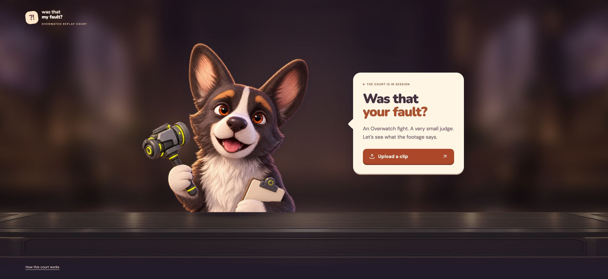
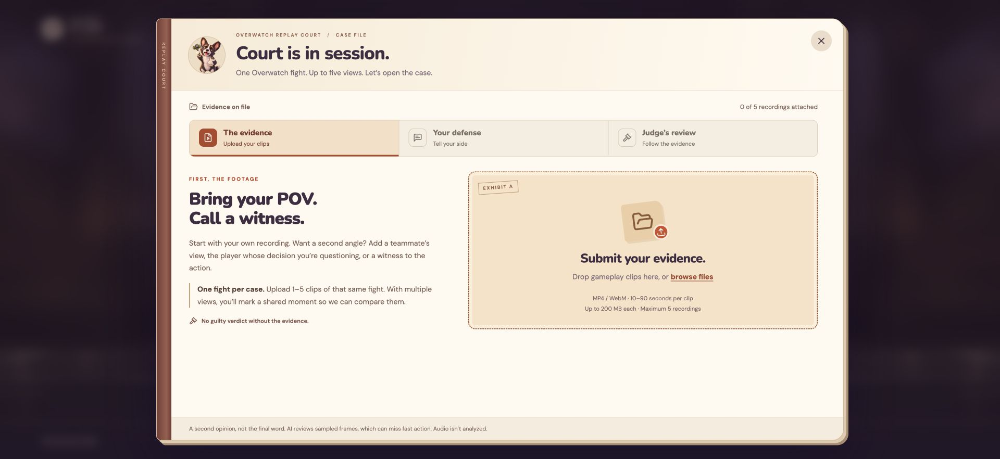
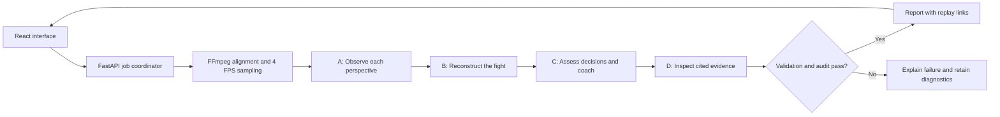

# Not My Fault

**Your teamfight. On trial.**

An Overwatch replay reviewer built at **Cal Hacks 13.0**. Upload one to five views
of the same fight, tell your side, and let Judge Murphy (Sojourn’s dog, in case you don't know :)) examine the footage.
The verdict comes with clickable evidence, a subjective blame estimate, and
something to try in your next match.



[View on Devpost](https://devpost.com/software/not-my-fault) ·
[How it works](#how-it-works) · [Run locally](#run-locally) ·
[Engineering decisions](#engineering-decisions) · [Team](#team) ·
[Project story](docs/DEVPOST.md)

## Why we built it

“No way that’s my fault.” One lost fight, five different stories. The scoreboard
isn’t settling the argument, so we gave a dog a gavel. We wanted a fun way to
revisit those moments with friends. If it takes even a little toxicity out of
the community along the way, even better.

## The experience

1. **Submit the evidence.** Add 1–5 MP4/WebM clips of the same fight, each
   10–90 seconds and up to 200 MB. Name the players and optionally add roles and heroes.
2. **Make your case.** Ask about a decision and add context. With multiple views,
   mark the same visible event in each recording to align them.
3. **Follow the review.** Watch actual pipeline stages progress from video
   preparation through observation, reconstruction, judgment, and evidence checking.
4. **Inspect the verdict.** Read the reasoning, switch perspectives, and click a
   timestamp to revisit the relevant moment. Download the report as JSON.



*Screenshots show the running frontend in this branch. The interface also uses
“Was that my fault?” as its opening question.*

**Status:** working local hackathon prototype. Automatic reviews use real uploaded
footage and OpenAI models through Codex CLI with a ChatGPT login. This repository
runs the application on your computer; it does not provide a hosted review service.

## How it works



Each observer gets one perspective in a fresh session. Reconstruction and judgment
use the resulting reports. The final AI checker receives newly decoded images
from the cited windows. Structured contracts and the publication gate decide
whether a report can reach the browser. User questions and context are supplied
as unverified context, not treated as established gameplay facts.

| Layer | Implementation |
| --- | --- |
| Interface | React, TypeScript, Vite, Motion, custom CSS |
| Browser contracts | Zod validation and recording/timestamp checks |
| API and jobs | Python, FastAPI, Uvicorn |
| Video processing | FFmpeg / ffprobe; aligned overlap and timestamped frames |
| AI execution | Fresh Codex CLI sessions; observation, reconstruction, judgment, audit |
| Backend contracts | Pydantic, evidence references, source hashes, stage gates |
| Tests | pytest, Vitest, React Testing Library |

## Engineering decisions

- **Evidence stays connected to playback.** The backend validates citations in the
  aligned timeline, then maps them back to each original recording. A finding is
  inspectable without manually searching through several clips.
- **Observation is separate from judgment.** Independent perspective reports feed
  the reconstruction before the judge makes a call. A separate AI session then
  inspects the cited footage; its agreement is an additional check, not proof of accuracy.
- **Failed reviews do not become fabricated results.** Invalid artifacts, failed
  audits, and unavailable model execution block publication. Unique review folders
  and an existing-output guard prevent old files from masquerading as fresh responses.
- **Async state has explicit ownership.** The browser cancels active work when
  appropriate and ignores stale responses. Changing recordings invalidates the old
  result and alignment confirmation.
- **Sampling has a budget.** The default is 4 FPS, with a 900-image limit per web
  model invocation and bounded format repair. Fast events between frames can still
  be missed. Adaptive sampling is future work.

For code navigation, start with [the review controller](frontend/src/useReview.ts),
[the API](backend/api/app.py), [the automatic runner](backend/api/codex_reviewer.py),
and [the pipeline contracts](backend/overjudge/).

## Run locally

Prerequisites: **Node.js 22+**, **Python 3.11 or 3.12**, **FFmpeg and ffprobe** on
`PATH`, and **Codex CLI signed in with ChatGPT** for automatic reviews.
On macOS, FFmpeg can be installed with `brew install ffmpeg`.

From a checkout containing `frontend/` and `backend/`:

```bash
python3 -m venv .venv
.venv/bin/python -m pip install -r backend/requirements.txt
npm --prefix frontend ci
cp -n .env.example .env
codex login
./dev.sh
```

Open **http://127.0.0.1:5174/**. The API runs at `127.0.0.1:3004`; Vite proxies
`/api` to it. The setup above targets macOS/Linux. Preserve any existing `.env`.

Automatic analysis uses your Codex allowance and sends selected frames and text
context to OpenAI. It does not require an OpenAI API key. For configuration,
manual handoffs, separate server commands, and troubleshooting, see the
[development guide](docs/DEVELOPMENT.md).

## Verification

```bash
source .venv/bin/activate
python -m pytest backend/tests -q
npm --prefix frontend test
npm --prefix frontend run build
```

Tests exercise video preparation, evidence bounds, stale-output protection,
cancellation, report validation, publication gates, and frontend interaction.
Model responses in automated tests are mocked, so the tests spend no model usage.
FFmpeg-dependent tests skip if the tools are unavailable. Passing these tests
checks software behavior; it does not establish the accuracy of gameplay judgments.

## Limits and next steps

- Reviews inspect sampled images without audio. Off-screen actions and fast
  ability sequences may be unavailable.
- Blame percentages are subjective estimates for the submitted moment. They are
  not measured causal shares; an inconclusive result can still include speculative estimates.
- The app is local and sessions are ephemeral. Closing an active review cancels
  it; closing a completed dialog keeps its result in the current page session.
  Server restarts do not restore browser jobs. Export reports you want to keep.
- Uploads and review artifacts are stored locally. Expired review folders are
  cleaned up when the backend starts; recordings are not automatically deleted
  exactly 24 hours after upload.

Next: denser sampling around disputed moments, one bounded reinspection request,
and evaluation against experienced players’ reviews.

## Team

Built collaboratively by UC Berkeley students at Cal Hacks 13.0. Contributions
below describe the implementation represented in this branch; areas overlap.

| Contributor | Focus |
| --- | --- |
| [@julianahyc1225](https://github.com/julianahyc1225) | Courtroom UI and frontend flow; web/API integration; automatic review orchestration; progress and evidence playback; alignment and stale-output fixes |
| [@LuQilin6](https://github.com/LuQilin6) | Stage A video intake and observation workflow; standalone observation automation; example footage outputs |
| [@xzptofu](https://github.com/xzptofu) | Stages B–D: reconstruction, judgment, audit, artifact contracts, validation, and integrated handoffs |

Special thanks to **Jianing Xu Wang** for hanging out with us on day one.

Codex also assisted development and debugging. Runtime AI reviews are described
above; automated test fixtures are identified separately from real analysis.

## Documentation and contributing

- [Development and operations](docs/DEVELOPMENT.md)
- [Web API and integration behavior](docs/WEB_INTEGRATION.md)
- [Manual pipeline workflow](docs/STAGE_B_ONWARD.md)
- [Hackathon story and submission draft](docs/DEVPOST.md)
- [Historical example outputs](docs/examples/2026-10-25/) — machine-specific snapshots
- [Contributing](CONTRIBUTING.md)

The repository and Python package retain the earlier `OverJudge` / `overjudge`
names. **Not My Fault** is the product name. This is an independent fan project,
not affiliated with Blizzard Entertainment.
