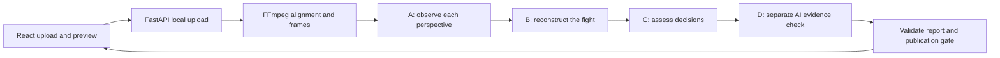

# Development and operations guide

A local Overwatch replay reviewer. Upload one to five perspectives of the same
fight, ask a question, and receive a cautious verdict with clickable video evidence.
The courtroom interface is React; the API and analysis pipeline are Python.

The current automatic reviewer uses **Codex CLI signed in with ChatGPT**. It uses
your Codex allowance and sends selected images and context to OpenAI. No OpenAI
API key is required. This is a local prototype, not a hosted multi-user service.

## Repository layout

```text
OverJudge/
├── frontend/
│   ├── src/
│   │   ├── api/contracts.ts    # Browser-side report validation
│   │   ├── components/        # Scene, mascot, dialog and verdict
│   │   ├── App.tsx            # Guided upload/review experience
│   │   └── useReview.ts       # Upload, polling, cancellation and playback
│   ├── public/images/         # Courtroom and character artwork
│   ├── tests/                 # Vitest + React Testing Library
│   └── package.json           # Frontend dependencies and commands
├── backend/
│   ├── api/
│   │   ├── app.py             # FastAPI routes, uploads and local jobs
│   │   └── codex_reviewer.py  # Automatic Codex CLI runner
│   ├── overjudge/             # Analysis, evidence contracts and provenance
│   ├── prompts/               # Versioned observer/judge/audit instructions
│   ├── config/                # Manual pipeline configuration template
│   ├── tests/                 # Python contract, pipeline and API tests
│   ├── main.py                # Manual pipeline CLI entry point
│   ├── requirements.in        # Direct dependencies
│   ├── requirements.txt       # Pinned backend/development dependencies
│   ├── inputs/videos/         # Local recordings; ignored
│   ├── outputs/               # Manual pipeline artifacts; ignored
│   └── work/clips/            # Temporary manual evidence clips; ignored
├── docs/                      # Architecture, workflows and original plan
├── .env.example               # Server configuration template
├── .env                       # Your local settings; ignored
├── .local/reviews/             # Uploaded clips and web review artifacts; ignored
├── .venv/                     # Local Python environment; ignored
├── pytest.ini                 # Backend test discovery from the repo root
└── dev.sh                     # Start frontend and backend together
```

The Python library is named `overjudge`; it is separate from the HTTP layer in
`backend/api`. TypeScript contracts live with the frontend because they are browser
validators, not code shared with Python. Python performs its own validation.

## Quick start

Run these commands **from the repository root**, one directory above this guide.

Prerequisites:

- Node.js 22+ and npm.
- Python 3.11.9 (team baseline); Python 3.12 is also tested.
- FFmpeg and ffprobe on PATH. On macOS: `brew install ffmpeg`.
- Codex CLI installed and signed in with ChatGPT: `codex login`.

```bash
python3 -m venv .venv
.venv/bin/python -m pip install -r backend/requirements.txt
npm --prefix frontend ci
cp -n .env.example .env
codex login status
./dev.sh
```

Copy the template only on first setup; preserve an existing `.env` and its local
settings. `dev.sh` adds `.venv/bin` to PATH, which also supports the project-local
FFmpeg installation on the development machine. External tools and environments
are not committed.

Open **[http://127.0.0.1:5174/](http://127.0.0.1:5174/)**.

| Service | Address | Responsibility |
| --- | --- | --- |
| React + Vite | `127.0.0.1:5174` | Upload form, preview, progress and results |
| FastAPI + Uvicorn | `127.0.0.1:3004` | Local files, analysis and validated reports |

Vite proxies `/api` to FastAPI. Both services bind only to localhost. Older
prototypes on ports 3001/5173 are separate applications. Press Ctrl+C in the
terminal running `dev.sh` to stop this app.

### Run the services separately

```bash
# Terminal 1, from the repository root
source .venv/bin/activate
python -m uvicorn api.app:app --app-dir backend --host 127.0.0.1 --port 3004

# Terminal 2, from the repository root
npm --prefix frontend run dev
```

## How a review works



1. The browser checks MP4/WebM recordings: 10–90 seconds and up to 200 MB each.
   For multiple perspectives, the user marks the same event in each clip.
2. The backend saves local copies and aligns the shared interval. FFmpeg extracts
   four frames per second, up to 360 frames per recording. Audio is not analyzed.
3. Fresh Codex sessions observe each perspective, reconstruct the fight, propose
   a verdict, then inspect frames from its cited evidence in a separate AI check.
4. Python validates artifacts, source hashes and timestamp bounds. Only a current
   passing evidence check releases a report. Failed checks never produce a fake
   fallback verdict.
5. The browser polls for progress, displays the report and seeks the original
   recording when an evidence link is clicked. Reports can be downloaded as JSON.

This is a **sampled-frame AI review, not a human audit**. It can miss fast actions
and should abstain when evidence is insufficient. The live 22-second test clip
took about four minutes; runtime varies with clip length and model settings.

**Current lifecycle:** closing the dialog during an active review cancels it;
closing a completed result retains it in the current browser session. Keep the
local server and page running until completion. Restarting the server does not
restore browser jobs; download completed reports before leaving the session.

## Configuration

Only the backend reads the root `.env`. Never put credentials in `VITE_*` variables
or frontend code; those would become browser-visible.

| Variable | Default | Meaning |
| --- | --- | --- |
| `REVIEW_EXECUTION` | `codex` | Automatic CLI reviewer; use `manual` for explicit operator handoff |
| `CODEX_REVIEW_MODEL` | Your Codex model setting | Optional model override |
| `CODEX_REVIEW_TIMEOUT_SECONDS` | `600` | Timeout per model invocation |
| `CODEX_CA_CERTIFICATE` | Unset | Existing trusted CA bundle, when needed by your network/runtime |

If Codex reports `workspace routing discovery failed`, run
`codex doctor --summary --no-color`. On this Mac the cause was TLS `UnknownIssuer`;
`CODEX_CA_CERTIFICATE=/etc/ssl/cert.pem` in the local `.env` fixed it using existing
macOS trusted roots. Certificate verification remains enabled. This path is
Mac-specific. Restart the backend after changing `.env`.

## Development and checks

```bash
# From the repository root; activation also exposes local FFmpeg if installed there
source .venv/bin/activate
python -m pytest -q
npm --prefix frontend test
npm --prefix frontend run build
python backend/main.py --help
git diff --check
```

Backend tests cover validation, cancellation, artifact provenance, timestamp
mapping and the publication gate. Model responses in automated tests are mocked;
tests do not consume Codex usage. FFmpeg-dependent tests skip if FFmpeg is missing.
Frontend tests cover the dialog and review lifecycle. The production build is
written to `frontend/dist/`; building it does not deploy anything.

To use the manual CLI, copy `backend/config/run.example.json` to
`backend/config/run.json`, supply actual inputs and interval, then run:

```bash
python backend/main.py validate --config backend/config/run.json
```

The example deliberately leaves the fight end unset. See the manual guide below
for observation submission, reconstruction, judgment and evidence audit commands.

## Files that stay off GitHub

Git ignores **`test-media/` and `calhacks-kit/` at any depth**, as well as recordings
in the backend input folders, `.local/`, generated outputs, `.env`, virtual
environments and `node_modules`. The existing `test-media` and `calhacks-kit`
folders above this repository remain local and are not copied into this repo.

Check before committing or pushing:

```bash
git status --short
git ls-files -- 'test-media/**' '**/test-media/**' 'calhacks-kit/**' '**/calhacks-kit/**'
```

The second command should print nothing. Ignore rules do not untrack files that
were already committed; inspect the staged changes before publishing.

## Further documentation

- [Detailed web/API integration and reviewer behavior](WEB_INTEGRATION.md)
- [Manual A/B/C/D workflow and report contracts](STAGE_B_ONWARD.md)
- [Original project plan](PROJECT_PLAN.md) — historical design, not current setup instructions
- [Historical UI verification](verification/README.md)

## Standalone automatic Stage A with Codex CLI


Install the Codex CLI and run `codex login`, choosing **Sign in with ChatGPT**.
Confirm `codex login status` says `Logged in using ChatGPT`. The runner requires
this login and removes `OPENAI_API_KEY` / `CODEX_API_KEY` from its child environment;
it does not fall back to API billing. Codex usage consumes your account allowance.

```bash
.venv/bin/python backend/main.py run --stage A --pov tank --config backend/config/run.json --execute
```

This prepares (or reuses) the assigned POV's frames, attaches them to a fresh
non-interactive `codex exec`, and automatically imports its Markdown report and
inspection attestation using the existing Stage A validators. You do not need to
open another chat or manually submit a successful response. Other POVs use the
same command with `--pov dps1`, `dps2`, `support1`, or `support2`.

`prepare` and `run` without `--execute` retain the manual workflow. The standalone CLI
automation supports Stage A only; the web app runs all four stages automatically. Each `--execute` invocation starts a
new analysis even when preparation is cached; avoid rerunning completed analyses
unless you want a new review. `--force` also regenerates the preparation job.

Optional flags:

- `--model MODEL`: select an available Codex model; otherwise the CLI default is
  used (user config is ignored for reproducibility).
- `--codex-timeout 900`: execution timeout in seconds (default 15 minutes).

Every attempt retains its prompt, frame-to-timestamp mapping, CLI version, JSONL
events, stderr, raw response (when produced), and status under
`backend/outputs/{run_id}/codex_execution/{pov}/{attempt}/`. Successful imports still have
`PASS_WITH_LIMITATIONS` and independent evidence audit `PENDING`. Model attestations
and structural checks do not prove visual accuracy. No audio is supplied.

The model receives full-resolution image attachments, the one-POV prompt, and
metadata in a fresh temporary working directory. The CLI uses a read-only sandbox,
ephemeral sessions, and no user config. It is instructed not to use tools or read
other files. This prevents repository context from being supplied automatically;
it is not an OS security boundary that denies reading all other filesystem paths.
There is no session resume or cross-POV prompt sharing.

Automatic runs accept at most 100 sampled frames; shorten the configured interval
or lower the sampling rate for larger jobs, preserving the sampling limitations.
A missing login, timeout, nonzero process exit, blocked model response, or invalid
report stops import and retains a BLOCKED attempt for inspection. No automatic
retries are performed, avoiding duplicate account usage after uncertain failures.

Codex execution options follow the [official non-interactive mode documentation](https://learn.chatgpt.com/docs/non-interactive-mode).

## Teammate example snapshots

Previously committed Stage A/B examples are preserved under
`docs/examples/2026-10-25/`. They are historical snapshots: embedded absolute paths
and hashes describe the original machine and are not portable run configuration.
New runtime outputs remain ignored. These examples came from the existing main
branch; no files from the local `test-media/` or `calhacks-kit/` are included.
